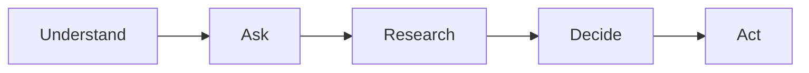

# ShopSense

A personalised shopping research agent that ranks products for you, cites a source for every claim, and tells
you when it isn't sure.

**AI-Powered Personalized Shopping Research Agent** · IT314 Software Engineering · Group 13

[](https://github.com/202401121-cmyk/AI-Powered-Personalized-Shopping-Research-Agent/actions/workflows/ci.yml)

## What it does

You describe what you need in your own words, such as "best laptop for coding under 70k". ShopSense works out
the product type, your use, your budget and your must-haves, then asks a few short questions about what matters
most to you. It researches Reddit, YouTube, review sites and web search in parallel, pulls out claims with their
exact quotes, matches different names for the same product, and checks the evidence. You get a ranked shortlist
with the reasons each product fits, how confident the ranking is, the source behind every claim, and current
prices with buy links. When a service fails or a fact can't be found, it keeps going and says what is missing.

## How a search works



Understand is the intake and criteria stages, Ask is the interview, Research is research, extract, match,
verify and enrich, Decide is decide and explain, and Act is commerce. Each stage has a typed input and output, a
time limit and a fallback, so one failure never stops the search.

| # | Stage | What it does | Fallback today | Limit | Today |
|---|---|---|---|---|---|
| 1 | intake | Reads the product type, use, budget, region, must-haves and exclusions | Keyword rules for product type, budget and region | 5 s | Built (US-02) |
| 2 | criteria | Picks 7 to 10 criteria for that product and use, each with a one-line definition | A fixed set for the category or its product family | 10 s | Built (US-03) |
| 3 | interview | Asks one question at a time and turns the answers into weighted priorities | Finishes with each criterion's default weight | 5 s per turn | Stub (US-05) |
| 4 | research | Searches Reddit, YouTube, review sites and the web in parallel | One query and no sources | 40 s | Stub (US-12) |
| 5 | extract | Pulls product mentions and claims, each with its exact quote | Nothing taken from that source | 15 s per source | Stub (US-14) |
| 6 | match | Groups different names and variants of the same product | Example products | 5 s | Stub (US-15) |
| 7 | verify | Settles one value per product and criterion; marks disputed and unknown values | Example values, sources ranked by tier | 2 s | Stub (US-16) |
| 8 | enrich | Looks up missing important facts for the top products | Nothing looked up | 20 s | Stub (US-41) |
| 9 | decide | Filters by must-haves and ranks by your priorities, in plain code | Example ranking | 2 s | Stub (US-17, US-18) |
| 10 | explain | Explains why each top product fits, citing its claims | One template sentence per product | 15 s | Stub (US-20) |
| 11 | commerce | Finds a current price and buy link for the exact model | No offers | 15 s | Stub (US-24) |

A whole search stops after 150 seconds and returns the best result so far, marked as partial. The pipeline keeps
its state in memory and never needs the database to finish; results are saved at the end.

## Project status

As of 25 October 2026, commit `dc1187c`.

| Area | Status | Story | Sprint |
|---|---|---|---|
| Repository, CI and secret scanning | Built | US-25 | 1 |
| Pipeline runner, 11 stage stubs, CLI and search API | Built | US-52 | 1 |
| LLM wrapper: four providers, fallback, context fitting | Built | US-26 | 1 |
| Intake: product type, use, budget and must-haves | Built | US-02 | 1 |
| Criteria with definitions, saved once, with fallback sets | Built | US-03 | 1 |
| Interview, one question at a time, and pre-search API | In progress | US-05 | 1 |
| Request box in the browser | Planned | US-01 | 1 |
| Research across sources, Reddit quality scores | Planned | US-12, US-13, US-27 | 2 |
| Claim extraction with exact quotes | Planned | US-14 | 2 |
| LLM circuit breaker and provider rotation | Planned | US-46 | 2 |
| Product matching (ML) | Planned | US-15 | 3 |
| Source trust, disputes and unsourced products (ML) | Planned | US-16, US-40 | 3 |
| Filtering and ranking | Planned | US-17, US-18 | 3 |
| Results page with clickable sources | Planned | US-21 | 3 |
| Smart interview (ML) | Planned | US-04 | 4 |
| Honest confidence and ties (ML) | Planned | US-19 | 4 |
| Explanations | Planned | US-20 | 4 |
| Database and login (Supabase) | Planned | US-30 | 4 |
| Recorded-run replay and CI quality gate | Planned | US-49 | 4 |
| Memory across searches (ML) | Planned | US-06 | 5 |
| Checked explanations (ML) | Planned | US-22 | 5 |
| Compare products and re-rank instantly | Planned | US-23 | 5 |
| Prices and buy links | Planned | US-24 | 5 |
| YouTube and hard-to-read pages | Planned | US-38 | 5 |
| Missing-fact lookup | Planned | US-41 | 5 |
| Worst-case test suite | Planned | US-50 | 6 |

On the baseline calendar, 25 October falls in Sprint 3 (19 Oct – 1 Nov). Five of the seven Sprint 1 stories are
merged; US-01 and US-05 are not on `main` yet.

## Quick start

### Prerequisites

- Python 3.11 or newer
- Git
- Node 20 or newer, only once the frontend app exists (it does not yet)

On Windows, use Git Bash or PowerShell, and run `git config core.autocrlf false` after cloning. The repository's
`.gitattributes` keeps line endings consistent.

### Backend

```bash
git clone https://github.com/202401121-cmyk/AI-Powered-Personalized-Shopping-Research-Agent.git
cd AI-Powered-Personalized-Shopping-Research-Agent/backend
python -m venv .venv
source .venv/bin/activate        # macOS and Linux
source .venv/Scripts/activate    # Windows, Git Bash
.venv\Scripts\Activate.ps1       # Windows, PowerShell
pip install -e ".[dev]"
cp ../.env.example ../.env       # then fill in only the keys your story needs
```

Then, from `backend/`:

```bash
pytest -q                                              # all tests
ruff check . && ruff format --check .                  # lint
mypy app                                               # strict type check
python -m app.cli "best laptop for coding under 70k"   # one search, end to end
uvicorn app.main:app --reload                          # the API on http://localhost:8000
```

The CLI prints what it understood, the criteria it will compare with their definitions, one interview question
(the interview is still a stub), and a shortlist. Most stages are still stubs, so the shortlist is fixed example
data for now. With the API running, `GET /api/health`
answers `{"status": "ok", ...}` and `POST /api/search` runs a search.

You need no API keys to develop. Without keys, intake uses its keyword rules and criteria use the fixed sets,
so the CLI, the API and every test still work. Tests never call a live API: `backend/tests/conftest.py` swaps in
a fake LLM client for every test.

### Optional live checks

These call real providers with the keys in your own `.env`. They never run in CI, never print a key, and skip
cleanly when no key is set.

```bash
python -m scripts.smoke_llm          # one tiny call per LLM provider; prints limits and latency
python -m evals.criteria.run_live    # generated criteria for six example briefs
```

`python -m evals.intake.run_rules_eval` needs no keys: it scores the keyword rules on 40 labelled requests.

## Configuration

Copy `.env.example` to `.env` and fill in only what your story needs. Today the code reads only the four LLM
keys, through `backend/config/models.yaml`; the rest are for stories still to come.

| Variable | What it is for | Read by code today |
|---|---|---|
| `APP_ENV` | Which environment the app runs in: development, test or production | No |
| `LOG_LEVEL` | How much the backend logs, for example INFO | No |
| `GROQ_API_KEY` | Groq, the first LLM provider tried | Yes |
| `GEMINI_API_KEY` | Google Gemini, the second; its free tier may train on prompts | Yes |
| `OPENROUTER_API_KEY` | OpenRouter, the third | Yes |
| `CEREBRAS_API_KEY` | Cerebras, the fourth | Yes |
| `SERPER_API_KEY` | Web and shopping search | No (US-12) |
| `REDDIT_CLIENT_ID` | Reddit API app id | No (US-12) |
| `REDDIT_CLIENT_SECRET` | Reddit API app secret | No (US-12) |
| `REDDIT_USER_AGENT` | How the app names itself to Reddit | No (US-12) |
| `YOUTUBE_API_KEY` | YouTube Data API | No (US-38) |
| `JINA_API_KEY` | Optional; raises Jina Reader's free rate limit for reading pages | No |
| `SUPABASE_URL` | The team's Supabase project | No (US-30) |
| `SUPABASE_ANON_KEY` | Supabase public key | No (US-30) |
| `SUPABASE_SERVICE_ROLE_KEY` | Supabase admin key; backend only, never in the browser | No (US-30) |
| `DATABASE_URL` | Postgres connection string from Supabase | No (US-30) |
| `NEXT_PUBLIC_API_URL` | Where the browser app finds the backend | No (frontend not built) |
| `NEXT_PUBLIC_SUPABASE_URL` | Supabase project for browser login | No (US-30) |
| `NEXT_PUBLIC_SUPABASE_ANON_KEY` | Supabase public key for browser login | No (US-30) |

Keys are never committed. Tasks that carry the shopper's own words (`PERSONAL_TASKS`) are never sent to a free
tier that may train on prompts; the LLM wrapper enforces this in `backend/app/llm/client.py`. How to get each key
and what to check: [docs/api-setup.md](docs/api-setup.md).

## Architecture

Stages talk to each other only through contracts: strict, frozen Pydantic models in `backend/app/contracts/`.
The contracts are exported to JSON Schema in `shared/contracts/`, and from there to TypeScript for the frontend,
so both sides always agree on the same shapes. Every stage implements the same small interface, `run` and
`fallback`. A better version of a stage is a new class with the same input and output ("replace, never
rewrite"), and the old version becomes its fallback. Code decides: the LLM never filters, scores or ranks
products, and every claim keeps its source. The ten build rules are in [CLAUDE.md](CLAUDE.md).

```
.
├── backend/
│   ├── app/
│   │   ├── contracts/       # typed input and output of every stage, plus one example search
│   │   ├── <stage>/         # one folder per stage: intake, criteria, interview, research, extract,
│   │   │                    #   entities (match), verify, enrich, decide, explain, commerce
│   │   ├── llm/             # the one LLM wrapper: providers, fitting, output parsing, fallback
│   │   ├── pipeline.py      # runs the search stages with time limits and fallbacks
│   │   ├── presearch.py     # intake, criteria and interview, one turn at a time
│   │   ├── cli.py           # python -m app.cli
│   │   └── main.py          # FastAPI app: /api/health and /api/search
│   ├── config/              # product categories, fallback criteria, LLM models
│   ├── evals/               # intake and criteria evaluation scripts
│   ├── scripts/             # contract export, LLM smoke test
│   └── tests/               # unit, contract, golden and fault tests, plus fakes
├── backlog/stories.yaml     # all 51 user stories with points, sprint and tier
├── docs/                    # API setup, elicitation kit, Sprint 1 kickoff
├── frontend/                # the Next.js app (US-01); only its CLAUDE.md so far
├── scripts/                 # GitHub issue creation, TypeScript type generation
├── shared/contracts/        # JSON Schemas and example data exported from the contracts
├── supabase/migrations/     # database migrations (none yet)
└── .github/                 # CI workflow, pull request and issue templates
```

## Development workflow

- One branch per story, named `feature/US-xx-short-name`, from a fresh `main`.
- Commit messages start with the story ID, for example `US-12: build queries from the rubric`.
- The person who did the work makes the commit, under their own name. The course checks this.
- Every change goes through a pull request with one review and green CI. Nobody pushes to `main`.
- Contract changes are team decisions, agreed in `#dev` first.
- The Definition of Done and the review checklist are in [CONTRIBUTING.md](CONTRIBUTING.md).

### CI jobs

Every pull request and every push to `main` runs [`.github/workflows/ci.yml`](.github/workflows/ci.yml).

| Job | Runs on | Checks |
|---|---|---|
| `backend` | Ubuntu, Python 3.11 | ruff lint and format, strict mypy, tests without live APIs with coverage, shared contracts up to date |
| `backend-windows` | Windows, Python 3.13 | tests without live APIs, shared contracts up to date |
| `secrets` | Ubuntu | TruffleHog scan of the whole history for leaked keys |
| `frontend` | Ubuntu, Node 20 | skips until the frontend app exists; then install, lint, type check and tests |

### Contracts and types

After any contract change, regenerate the shared files and commit them in the same pull request:

```bash
cd backend && python -m scripts.export_contracts    # writes shared/contracts/
bash scripts/gen-frontend-types.sh                  # from the repo root (takes several minutes); writes frontend/src/types/contracts/
```

CI runs the export again and fails if `shared/contracts/` changes, so the frontend can never drift from the
backend. The TypeScript types are generated on each machine and not committed.

## Testing

| Folder | What it proves | Tests |
|---|---|---|
| `backend/tests/unit/` | The logic of each module: parsers, lexicon, LLM wrapper, pipeline, CLI, API | 398 |
| `backend/tests/contract/` | Every contract rule, and each stage's input and output | 88 |
| `backend/tests/golden/` | Malformed LLM replies end in valid output or a clean fallback, never a crash | 70 |
| `backend/tests/faults/` | Forcing a stage to fail triggers its fallback | 8 |
| `backend/tests/fakes/` | A fake LLM client and provider for tests (helpers, no tests) | — |

```bash
pytest -q                  # all 564 tests
pytest tests/contract -q   # contract tests only
pytest -q --cov            # with coverage
```

Coverage must stay at 70% or more for `backend/app/` (`fail_under` in `backend/pyproject.toml`). The team rule
in [CLAUDE.md](CLAUDE.md) asks for 80% on `app/decide/` once it is built. Any new LLM parser needs golden tests,
and any new fallback needs a fault test.

## Team

| Member | Role |
|---|---|
| Om Pandya | ML Engineer, Product Owner, group leader |
| Rushiraj Navar | ML Engineer |
| Jhanvi Barot | AI Engineer (LLM integration) |
| Harshkumar Kodavala | Data & Evaluation Engineer |
| Palak Patel | QA Engineer |
| Pal Jalodara | Backend Engineer |
| Vaishvi Mehta | Backend Engineer |
| Jenish Kavad | Backend Engineer |
| Yashkumar Patel | Frontend Engineer |
| Manu Pardhan | Frontend Engineer & Testing |

Scrum Master rotates each sprint: 1 Jhanvi Barot · 2 Yashkumar Patel · 3 Vaishvi Mehta · 4 Harshkumar Kodavala ·
5 Pal Jalodara · 6 Palak Patel.

## Roadmap

Six two-week sprints. The backlog has 51 stories worth 239 points: 216 core, 15 Plus and 8 Stretch.

| Sprint | Dates | Goal | Core points |
|---|---|---|---|
| 1 | 21 Sep – 4 Oct | The whole pipeline runs end to end and understands the shopper | 36 |
| 2 | 5 – 18 Oct | Real research and evidence, with the test safety net | 37 |
| 3 | 19 Oct – 1 Nov | Matched products, verified claims, correct filtering and ranking | 40 |
| 4 | 2 – 15 Nov | Short interview, confidence, explanations, login, quality gate | 36 |
| 5 | 16 – 29 Nov | Memory, enrichment, checked citations, compare, prices, YouTube | 36 (+5 Plus) |
| 6 | 30 Nov – 13 Dec | Worst-case proof, measurement and presentation | 31 (+10 Plus, +8 Stretch) |

Dates are the baseline; the team adjusts them at sprint reviews.

## Documentation

- [CONTRIBUTING.md](CONTRIBUTING.md): setup, how to build a story, review checklist, Definition of Done
- [CLAUDE.md](CLAUDE.md): the ten build rules and the conventions every Claude Code session follows
- [backend/CLAUDE.md](backend/CLAUDE.md): the stage folder layout and how to test a stage
- [frontend/CLAUDE.md](frontend/CLAUDE.md): generated types, mock data and the states every screen must show
- [docs/api-setup.md](docs/api-setup.md): every API key, where to get it and what to check
- [docs/elicitation-kit.md](docs/elicitation-kit.md): survey, interview, observation and expert templates
- [docs/sprint-1-kickoff.md](docs/sprint-1-kickoff.md): Sprint 1 checklist, planning agenda and contract review
- [supabase/migrations/README.md](supabase/migrations/README.md): how to add a database migration
- [backlog/stories.yaml](backlog/stories.yaml): all user stories, front and back of the card
- [shared/contracts/](shared/contracts/): exported JSON Schemas and example data for the frontend
- [.github/pull_request_template.md](.github/pull_request_template.md): the checklist on every pull request

Project plan and product document: shared in the team's Slack (#general).

## Collaboration

All code, issues and pull requests live on GitHub. All communication happens on Slack:

| Channel | Used for |
|---|---|
| `#general` | Announcements, the project plan and product document |
| `#standup` | The daily standup thread: yesterday, today, blockers |
| `#dev` | Technical questions, blockers and proposed contract changes |
| `#elicitation` | Survey, interview and observation results |
| `#ceremonies` | Sprint planning, reviews and team decisions |
