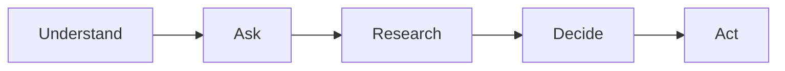

# ShopSense

A personalised shopping research agent that ranks products for you, cites a source for every claim, and tells
you when it isn't sure.

**AI-Powered Personalized Shopping Research Agent** · IT314 Software Engineering · Group 13

[](https://github.com/202401121-cmyk/Group13/actions/workflows/ci.yml)

## What it does

You describe what you need in your own words, such as "best laptop for coding under 70k". ShopSense works out
the product type, your use, your budget and your must-haves, then asks a few short questions about what matters
most to you. It researches Reddit, YouTube, review sites and web search in parallel, pulls out claims with their
exact quotes, matches different names for the same product, and checks the evidence. You get a ranked shortlist
with the reasons each product fits, how confident the ranking is, the source behind every claim, and current
prices with buy links. When a service fails or a fact can't be found, it keeps going and says what is missing.

**At the end of Sprint 1** the whole path runs, in the browser and in the terminal: you type a request, ShopSense
says what it understood (product, use, budget, region and rules), shows the criteria it will compare with a
definition for each, interviews you one question at a time, and turns your answers into a brief. The research and
ranking stages are still placeholders, so every search returns the same example laptops; the real research,
matching and ranking arrive in Sprints 2 and 3. The request is saved to the database when one is set up, and
everything still works without it, or without any API key.

## How a search works



Understand is the intake and criteria stages, Ask is the interview, Research is research, extract, match,
verify and enrich, Decide is decide and explain, and Act is commerce. Each stage has a typed input and output, a
time limit and a fallback, so one failure never stops the search.

| # | Stage | What it does | Fallback today | Limit | Today |
|---|---|---|---|---|---|
| 1 | intake | Reads the product type, use, budget, region, must-haves and exclusions | Keyword rules for product type, budget and region | 5 s | Built (US-02) |
| 2 | criteria | Picks 7 to 10 criteria for that product and use, each with a one-line definition | A fixed set for the category or its product family | 10 s | Built (US-03) |
| 3 | interview | Asks one question at a time and turns the answers into weighted priorities | Finishes with each criterion's default weight | 5 s per turn | Built (US-05) |
| 4 | research | Searches Reddit, YouTube, review sites and the web in parallel | One query and no sources | 40 s | Placeholder; the Reddit source is built (US-12) |
| 5 | extract | Pulls product mentions and claims, each with its exact quote | Nothing taken from that source | 15 s per source | Placeholder (US-14) |
| 6 | match | Groups different names and variants of the same product | Example products | 5 s | Placeholder (US-15) |
| 7 | verify | Settles one value per product and criterion; marks disputed and unknown values | Example values, sources ranked by tier | 2 s | Placeholder (US-16) |
| 8 | enrich | Looks up missing important facts for the top products | Nothing looked up | 20 s | Placeholder (US-41) |
| 9 | decide | Filters by must-haves and ranks by your priorities, in plain code | Example ranking | 2 s | Placeholder (US-17, US-18) |
| 10 | explain | Explains why each top product fits, citing its claims | One template sentence per product | 15 s | Placeholder (US-20) |
| 11 | commerce | Finds a current price and buy link for the exact model | No offers | 15 s | Placeholder (US-24) |

A whole search stops after 150 seconds and returns the best result so far, marked as partial. The pipeline keeps
its state in memory and never needs the database to finish.

## Sprint 1 status

Checked against `main` on 7 November 2026. "Merged" means the code and its tests are on `main`. The Sprint 1
verification found 18 failures; the fix pack and its re-check are the last step of the sprint.

| Story or task | Owner | Status | Pull requests | Docs |
|---|---|---|---|---|
| US-52 Walking skeleton: pipeline runner, 11 stage placeholders, CLI and search API | Pal Jalodara | Merged | #1, #7 | [docs/frontend-api.md](docs/frontend-api.md) |
| US-25 Repository, CI and secret scanning | Palak Patel | Merged | #2, #3, #9, #12, #16, #30 | [CI workflow](.github/workflows/ci.yml) |
| US-26 One LLM wrapper with fallback and context fitting | Jhanvi Barot | Merged | #4, #18 | [docs/api-setup.md](docs/api-setup.md) |
| US-02 Detect category, use, budget and rules | Jhanvi Barot | Merged | #5 | |
| US-03 Category-specific criteria | Jhanvi Barot | Merged | #6 | |
| US-05 One question at a time, and the pre-search API | Jenish Kavad | Merged | #8, #28 | [docs/api/presearch.md](docs/api/presearch.md) |
| US-01 Describe the need in plain words: the request saved to the database | Vaishvi Mehta | Merged | #17, #21, #22 | [docs/database.md](docs/database.md) |
| US-01 and the frontend: request box, interview, brief and results screens | Yashkumar Patel, Manu Pardhan | Merged | #24, #32 | [frontend/README.md](frontend/README.md), [decision 0001](docs/decisions/0001-frontend-tanstack-start.md) |
| ML workspace, public datasets and the matching baseline | Om Pandya, Rushiraj Navar, Palak Patel | Merged | #10, #13, #14, #15 | [ml/README.md](ml/README.md), [ml/MODELS.md](ml/MODELS.md) |
| API sign-ups, smoke test and terms check | Jenish Kavad | Merged | #28 | [docs/api-setup.md](docs/api-setup.md) |
| Full-stack set-up: one-command run, doctor, live test | Pal Jalodara | Merged | #28 | [docs/setup.md](docs/setup.md) |
| Elicitation: survey, interviews, observation, expert interview, write-up | Jhanvi, Om, Rushiraj, Jenish, Harshkumar, Pal | In progress | | [docs/elicitation-kit.md](docs/elicitation-kit.md) |
| Sprint 1 review check and close-out | Palak Patel, Om Pandya | Review check merged; fix pack and re-check in progress | #33 to #37 | |

Merged ahead of plan (Sprint 2 stories): US-46 LLM routing by data class (#19), and the Reddit source of US-12
(#20; the rest of US-12 is Sprint 2).

## Quick start

The full guide, with every setting, the drills and troubleshooting, is [docs/setup.md](docs/setup.md). Keys:
[docs/api-setup.md](docs/api-setup.md). The database: [docs/database.md](docs/database.md).

### Prerequisites

- Git, Python 3.11 or newer, and Node 20.19 or newer.
- On Windows, use Git Bash or PowerShell, and run `git config core.autocrlf false` after cloning (the repository's
  `.gitattributes` keeps line endings consistent). Keep the clone and its virtual environment in a short path,
  such as `C:\dev\Group13`: installing numpy fails under long paths ([ml/README.md](ml/README.md) has the other fix).

### Backend

```bash
git clone https://github.com/202401121-cmyk/Group13.git
cd Group13/backend
python -m venv .venv
source .venv/Scripts/activate    # Windows, Git Bash  (macOS and Linux: source .venv/bin/activate)
                                 # Windows, PowerShell: .venv\Scripts\Activate.ps1
pip install -e ".[dev]"
cp ../.env.example ../.env       # optional: add only the keys you need
python -m app.cli "best laptop for coding under 70k"   # one search in the terminal
uvicorn app.main:app --port 8000                       # the API on http://localhost:8000
```

You need no API keys to develop. Without keys, intake uses its keyword rules and criteria use the fixed sets, and
without `DATABASE_URL` nothing is saved; the CLI, the API and every test still work.

### Frontend

In a second terminal, from the repository root:

```bash
cd frontend
npm ci              # also generates the contract types
npm run dev         # http://localhost:3000, mock mode: built-in sample data, nothing sent anywhere
```

For live mode against your local backend, copy `frontend/.env.example` to `frontend/.env.local` (it sets
`VITE_API_MODE=live` and `VITE_API_BASE_URL=http://localhost:8000`), or use `scripts/dev.py` below.

### ML workspace

From the repository root, with the backend's virtual environment active:

```bash
pip install -r ml/requirements.txt
python ml/scripts/check_labels.py ml/labelling/pairs_template.csv
python ml/scripts/kappa.py ml/examples/pairs_labeller_a.csv ml/examples/pairs_labeller_b.csv --min 0.8
python ml/scripts/match_baseline.py all --out ml/results/matching_baseline.json   # needs the raw data: ml/DATA.md
```

### Everything at once

From the repository root, with the backend's virtual environment active:

```bash
python scripts/doctor.py     # checks this machine: versions, installs, settings, database, ports; prints fixes
python scripts/dev.py        # backend and frontend together, live mode; Ctrl+C stops both
python scripts/dev.py --no-db    # the same, with the database off
python scripts/dev.py --mock     # the frontend alone, with sample data
```

## Tests and checks

CI runs all of these except the frontend's `npm run build` and `npm run test:e2e`, which you run by hand
([`.github/workflows/ci.yml`](.github/workflows/ci.yml)). Run them with the backend's virtual environment active.
Tests never call a live API.

```bash
# backend (from backend/)
ruff check . && ruff format --check .
mypy app
pytest -q -m "not live" --cov          # coverage must stay at 70% or more
python -m scripts.export_contracts && git diff --exit-code -- ../shared/contracts

# frontend (from frontend/)
npm ci && npm run lint && npm run typecheck && npm test && npm run build
npx playwright install chromium        # once: the browser the next command needs
npm run test:e2e                       # the whole flow in mock mode, with an accessibility check on every page

# ml (from the root)
pip install -e "backend[dev]" -r ml/requirements.txt && python -m pytest ml/tests -q
```

| CI job | Runs on | Checks |
|---|---|---|
| `backend` | Ubuntu, Python 3.11, with a throwaway Postgres 17 | ruff lint and format, strict mypy, tests (including the database tests) with coverage, contracts up to date |
| `backend-windows` | Windows, Python 3.13 | tests, contracts up to date |
| `ml` | Ubuntu, Python 3.11 | lint, strict mypy, tests, the labelling and kappa scripts, no raw data or model files tracked |
| `secrets` | Ubuntu | TruffleHog scan of the whole history for leaked keys |
| `frontend` | Ubuntu, Node 20 | install, lint, type check and tests |

The badge at the top shows whether `main` is green. Calls to real services are separate and never run in CI:
`python -m scripts.smoke_apis` (from `backend/`) checks every configured key, and the live end-to-end test is in
[docs/setup.md](docs/setup.md).

### Test folders

| Folder | What it proves |
|---|---|
| `backend/tests/unit/` | The logic of each module, the API, the CLI and the set-up scripts |
| `backend/tests/contract/` | Every contract rule, and each stage's input and output |
| `backend/tests/golden/` | Malformed LLM replies end in valid output or a clean fallback, never a crash |
| `backend/tests/faults/` | Forcing a stage to fail triggers its fallback |
| `backend/tests/integration/` | The requests table on a real Postgres (marker `db`) |
| `backend/tests/live/` | Real services, only with `RUN_LIVE_TESTS=1` |
| `frontend/src/test/` | The API client, adapters, routing, screens and the colour contrast of the design tokens |
| `frontend/e2e/` | The whole flow in a browser, with an accessibility check (and, on purpose only, the live flow) |
| `ml/tests/` | The labelling checks, kappa, the matching metrics and baseline, and the pair-set loaders |

Any new LLM parser needs golden tests, and any new fallback needs a fault test. The team rule asks for 80% coverage
on `backend/app/decide/` once it is built.

## Layout

Stages talk to each other only through contracts: strict, frozen Pydantic models in `backend/app/contracts/`,
exported to JSON Schema in `shared/contracts/` and from there to TypeScript for the frontend. Code decides: the LLM
never filters, scores or ranks products, and every claim keeps its source. The ten build rules are in
[CONTRIBUTING.md](CONTRIBUTING.md#the-ten-build-rules).

```
.
├── backend/             # FastAPI app and the 11 search stages (app/), configs, evals, scripts and tests
├── frontend/            # the web app: TanStack Start, Vite, React and Tailwind, with mock and live modes
├── ml/                  # labelling tools, public datasets, the matching baseline and model cards
├── shared/contracts/    # JSON Schemas and example data exported from the backend's contracts
├── supabase/            # database migrations for the team's Supabase project
├── scripts/             # dev.py, doctor.py, the saved-request check, contract type generation, issue creation
├── docs/                # set-up, API keys and terms, the database, the frontend's API, decisions, elicitation
├── backlog/             # stories.yaml: all 51 user stories with points, sprint and tier
└── .github/             # the CI workflow, the pull request template and the issue templates
```

## Team

| Member | Role | Main areas |
|---|---|---|
| Om Pandya | ML Engineer, Product Owner, group leader | The backlog, reviews and merges; product matching, the adaptive interview, preference memory |
| Rushiraj Navar | ML Engineer | Source trust, ranking confidence, the citation check, evaluation runners |
| Jhanvi Barot | AI Engineer (LLM integration) | The LLM wrapper, intent detection, criteria, claim extraction, explanations |
| Harshkumar Kodavala | Data & Evaluation Engineer | Test data, recorded-run replay and the quality gate, login and data isolation, metrics |
| Palak Patel | QA Engineer | CI, golden tests, the worst-case suite, sprint review checks |
| Pal Jalodara | Backend Engineer | The walking skeleton, untrusted content, the rubric, failure handling, caching |
| Vaishvi Mehta | Backend Engineer | The database and migrations, Reddit quality, filtering and ranking, rate limits |
| Jenish Kavad | Backend Engineer | The interview and pre-search API, research and fetching, exclusions, the evidence API, prices |
| Yashkumar Patel | Frontend Engineer | The app shell, request box, research progress, results page, login, compare |
| Manu Pardhan | Frontend Engineer & Testing | The interview chat, rubric editor, confidence and explanation views, accessibility |

Scrum Master rotates each sprint: 1 Jhanvi Barot · 2 Yashkumar Patel · 3 Vaishvi Mehta · 4 Harshkumar Kodavala ·
5 Pal Jalodara · 6 Palak Patel.

## Calendar

### Original plan (re-planned at the Sprint 1 review)

Six two-week sprints. The backlog has 51 stories worth 239 points: 216 core, 15 Plus and 8 Stretch.

| Sprint | Dates | Goal | Core points |
|---|---|---|---|
| 1 | 21 Sep – 4 Oct | The whole pipeline runs end to end and understands the shopper | 36 |
| 2 | 5 – 18 Oct | Real research and evidence, with the test safety net | 37 |
| 3 | 19 Oct – 1 Nov | Matched products, verified claims, correct filtering and ranking | 40 |
| 4 | 2 – 15 Nov | Short interview, confidence, explanations, login, quality gate | 36 |
| 5 | 16 – 29 Nov | Memory, enrichment, checked citations, compare, prices, YouTube | 36 (+5 Plus) |
| 6 | 30 Nov – 13 Dec | Worst-case proof, measurement and presentation | 31 (+10 Plus, +8 Stretch) |

Sprint 1 ran past its planned dates; the new dates are set at the Sprint 1 review and replace this table.

## How we work

- One branch per story or task: `feature/US-xx-short-name` for a story, `fix/...`, `chore/...` or `docs/...` for
  the rest, always from a fresh `main`.
- Commit messages start with the story ID or the task prefix, for example `US-12: build queries from the rubric`,
  `CI: ...`, `S1: ...`, `docs: ...` or `fix: ...`.
- Each task is built from a written prompt in the owner's own clone, up to one local commit. The owner reviews it,
  pushes and opens the pull request.
- The person who did the work makes the commit, under their own name. The course checks this.
- Every change goes through a pull request with green CI and a named reviewer. Om merges, and may do so without
  waiting for the approval. `main` is not protected, by team decision, but nobody pushes to it directly.
- Contract changes are team decisions: the model, the exported schemas and the regenerated frontend types go in
  one pull request.
- Nobody commits keys or `.env` files. Keys live only in your own root `.env`.
- The Definition of Done and the review checklist are in [CONTRIBUTING.md](CONTRIBUTING.md).

## Documentation

- [docs/setup.md](docs/setup.md): install, every setting, run everything, check your machine, drills, troubleshooting
- [docs/api-setup.md](docs/api-setup.md): every outside service, its key, free limits, terms and fallback
- [docs/database.md](docs/database.md): the optional database, its table, security and live check
- [docs/frontend-api.md](docs/frontend-api.md): every route the backend serves, and what it can't do yet
- [docs/api/presearch.md](docs/api/presearch.md): the pre-search routes in detail, with examples
- [docs/decisions/](docs/decisions/): recorded decisions, such as the frontend's stack
- [docs/elicitation-kit.md](docs/elicitation-kit.md): survey, interview, observation and expert templates
- [docs/sprint-1-kickoff.md](docs/sprint-1-kickoff.md): the Sprint 1 checklist and planning agenda
- [CONTRIBUTING.md](CONTRIBUTING.md): setup, how to build a story, the ten build rules, review checklist, Definition
  of Done
- [frontend/README.md](frontend/README.md): the frontend's stack, commands and design notes
- [ml/README.md](ml/README.md): the ML workspace, its data rules and commands
- [supabase/migrations/README.md](supabase/migrations/README.md): how to add a database migration
- [backlog/stories.yaml](backlog/stories.yaml): all user stories, front and back of the card
- [shared/contracts/](shared/contracts/): exported JSON Schemas and example data
- [.github/pull_request_template.md](.github/pull_request_template.md): the checklist on every pull request

Project plan and product document: shared in the team's Slack (#general).

## Collaboration

All code, issues and pull requests live on GitHub. All communication happens on Slack:

| Channel | Used for |
|---|---|
| `#general` | Announcements, the project plan and product document |
| `#standup` | The daily standup thread: yesterday, today, blockers |
| `#dev` | Technical questions, blockers and proposed contract changes |
| `#elicitation` | Survey, interview and observation results |
| `#ceremonies` | Sprint planning, reviews and team decisions |
