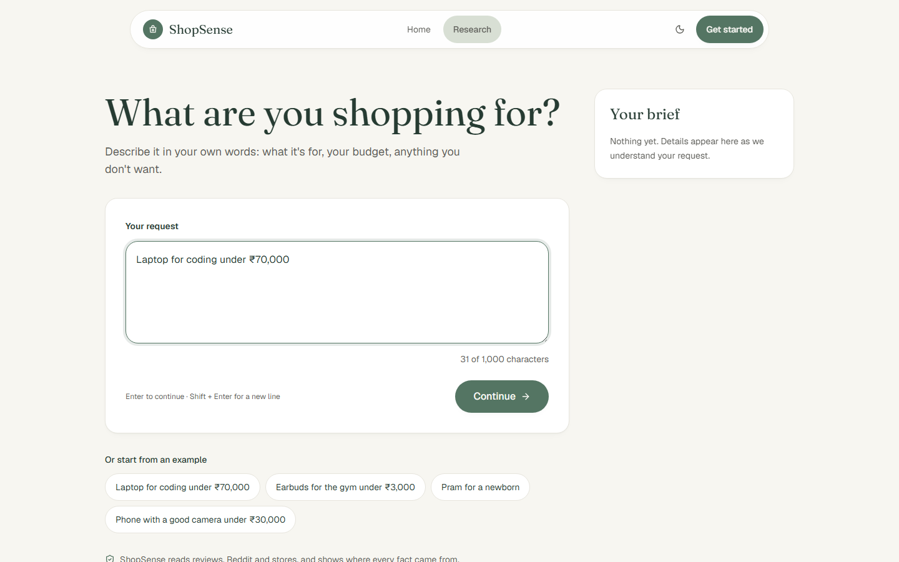
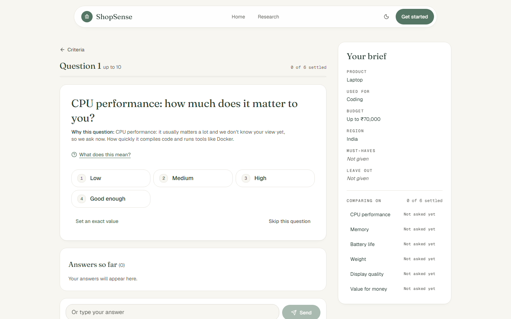
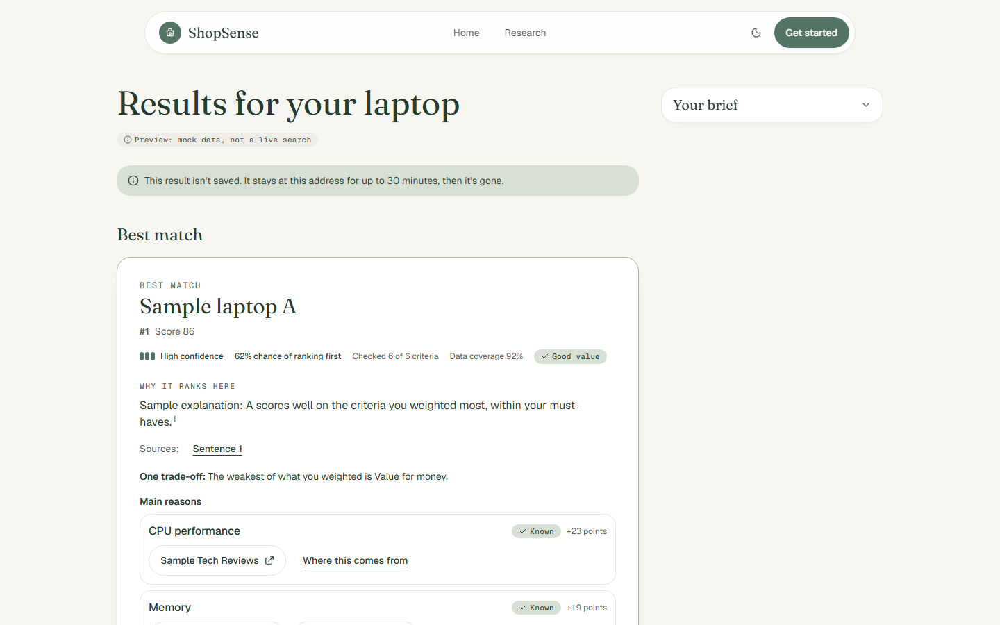
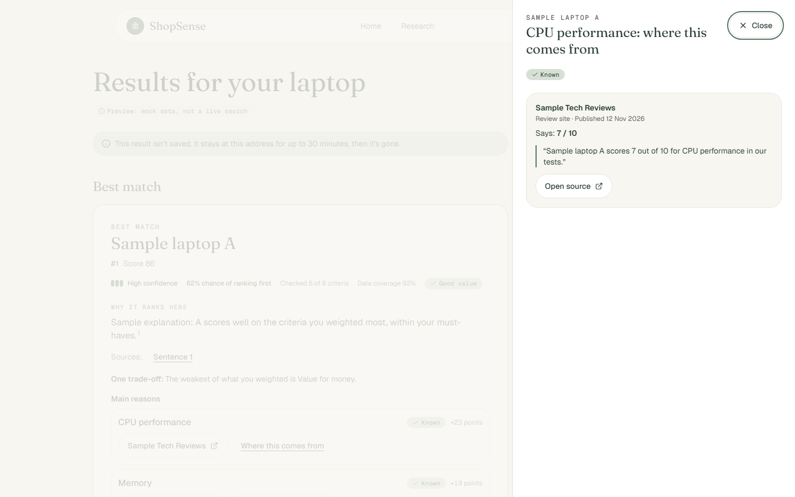
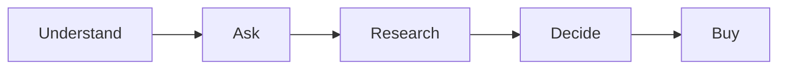

# ShopSense

Tell it what you need in plain words; it researches, ranks and explains a shortlist, with a source behind every claim.

[](https://github.com/202401121-cmyk/Group13/actions/workflows/ci.yml)

IT314 Software Engineering · Group 13

## What it does

You describe what you want, such as "laptop for coding under ₹70,000", and answer a few short questions about what
matters to you. ShopSense reads Reddit, YouTube, review sites and web search, and gives you a ranked shortlist with the
reasons each product fits, how sure it is, the source behind every claim, and a current price where it finds one.

What makes it different:

- **A source behind every claim.** Every fact keeps its link, its exact quote and when it was read. A product no source
  mentions is never shown.
- **Honest confidence and ties.** The ranking is simulated 1,000 times, each weight and score varied within its
  uncertainty, so it can say how likely each product is to be first, and "too close to call" when two are.
- **Must-haves are never broken.** A product over your budget or against a rule you set is held back, with the reason.
- **Code decides, not the AI.** A large language model (LLM), the AI text service, reads and writes text; plain code
  filters, scores and ranks.
- **Private text stays private.** What you type goes only to a provider that does not train on it.
- **It keeps working when a service fails.** Every stage has a time limit and a fallback (a simpler backup way to do
  the job), and the result says what is missing.

Not everything is finished yet; the [known limits](#what-works-today) come first in "What works today".

## Screenshots

The app in mock mode, with built-in sample data only (no real products, people or prices).

| Your request | One question at a time |
| --- | --- |
|  |  |
| **The ranked results** | **Where a claim comes from** |
|  |  |

## How a search works



The five steps are made of 11 stages: Understand is intake and criteria; Ask is the interview; Research covers
research (searching), extract, match, verify and enrich; Decide is decide and explain; Buy is commerce. Each stage has
a typed input and output, a time limit and a fallback, so one failure never stops the search. The limits are
`STAGE_TIME_LIMITS_S` in [backend/app/contracts/common.py](backend/app/contracts/common.py). A US- number is a user
story in [backlog/stories.yaml](backlog/stories.yaml).

| # | Stage | What it does | Today | Fallback | Limit |
| --- | --- | --- | --- | --- | --- |
| 1 | intake | Reads the product type, use, budget, must-haves and exclusions | Built (US-01, US-02) | Keyword rules | 5 s |
| 2 | criteria | Picks 6 to 10 criteria for that product and use, each with a plain definition | Built (US-03, US-07) | A fixed set for the category or its product family | 10 s |
| 3 | interview | Asks one question at a time, the most telling first, and stops once your top priorities are clear (at most 10) | Built (US-04, US-05, US-08, US-39) | The fixed question order | 5 s a turn |
| 4 | research | Searches Reddit archives, web search, review sites and YouTube in parallel | Built (US-12, US-13, US-27, US-28, US-38) | No sources, said in the result | 40 s |
| 5 | extract | Pulls product mentions and claims, each with its exact quote | Built (US-14, US-28) | Nothing taken from that source | 15 s a source |
| 6 | match | Groups different names and variants of the same product | Built (US-15): matching names spelled a little differently; a trained matcher can be switched on (`MATCHER=model`) | Every name kept apart | 5 s |
| 7 | verify | Settles one value per product and criterion, weighing sources by trust; marks disputed and unknown | Built (US-16, US-40) | Sources ranked by site type | 2 s |
| 8 | enrich | Looks up missing facts for the top products | **Not built yet** (US-41, Sprint 5) | Looks nothing up | 20 s |
| 9 | decide | Filters by must-haves and budget, ranks by your priorities, measures confidence | Built (US-17, US-18, US-19) | The plain weighted ranking if the simulations fail; a built-in example ranking, marked as an example, if the stage fails | 2 s |
| 10 | explain | Says why each top product fits, citing its claims | Built (US-20) | Fixed-wording sentences from the same facts | 15 s |
| 11 | commerce | Finds a current price and buy link for the top 3 products | Built (US-24) | A store search link, no offers | 15 s |

A whole search stops after 150 seconds (`SEARCH_TIME_LIMIT_S`) and returns the best result so far, marked as partial.
The pipeline keeps its state in memory and never needs the database to finish.

## What works today

**Known limits first.**

- **Every live result is still labelled "sample results".** The enrich stage is a placeholder, and any placeholder
  adds the note "These are sample results while live research is being built. They are not real recommendations."
  (`SAMPLE_NOTE` in [backend/app/pipeline.py](backend/app/pipeline.py); seen live in the
  [Sprint 3 check](docs/reviews/sprint-3-check.md)). Enrich, which looks up missing facts, is US-41 in Sprint 5.
- **Live searches have not yet ranked products.** In the Sprint 4 live baseline (17 Nov), four of five test searches
  ran and ranked nothing (the fifth stopped to ask a question): all 49 products found were held back because no
  price was found, and extraction was limited by the providers' per-minute capacity
  ([docs/evaluation/sprint-4-live.md](docs/evaluation/sprint-4-live.md)). The extraction fix since then (#135) has
  not been measured in a recorded live run yet.
- **There is no login yet.** Every search runs as a guest (US-30).

Everything below is on `main`, with the story or task that asked for it and the pull requests that built it
(`https://github.com/202401121-cmyk/Group13/pull/<number>`). FE-, DEP- and ML- are team tasks, not stories.

| Area | Feature | Story | Pull requests |
| --- | --- | --- | --- |
| Understanding the shopper | Your request read into product type, use, budget, must-haves and exclusions; one question when it is unclear | US-01, US-02 | #5, #17, #40 |
| | Criteria for that product and use, each with a plain-English definition | US-03, US-07 | #6, #137, #138 |
| | One question at a time; rough answers like "medium", questions, skips and off-topic replies understood | US-05, US-08, US-39 | #8, #55, #56, #67, #128 |
| | A smart interview: the most telling question first, stopping once your top priorities are clear (at most 10 questions). Its target, 30% fewer questions than the fixed order, is not met yet | US-04 | #129, #130 |
| | "What does this mean?" for every technical term, in plain words | US-07 | #97, #137 |
| | Must-haves kept apart from preferences, brands ruled out, and your criteria and their weights editable | US-09, US-10 | #93, #94, #102, #122, #123 |
| Research and evidence | Reddit, web search, review sites and YouTube searched in parallel | US-12, US-27, US-38 | #20, #57, #60, #61, #92, #132 |
| | Reddit posts scored for quality, and each person counted once | US-13 | #64, #68 |
| | Claims taken out with their exact quotes | US-14 | #63, #65, #109, #112, #115 |
| | Web text treated as data, never as instructions | US-28 | #62 |
| | Different names for the same product matched (a trained matcher is ready, switched off by default) | US-15 | #82, #88, #89, #90, #105, #117 |
| | Sources weighted by trust; disputed and unknown values marked | US-16 | #59, #87, #104 |
| | A product with no source is never shown | US-40 | #98 |
| Ranking and results | Products that break a must-have or the budget are held back, with the reason | US-17 | #86, #96, #111 |
| | Ranking on your priorities, with how much evidence each score has | US-18 | #110 |
| | Each product's chance of being first, and ties | US-19 | #125 |
| | Why each top product fits, in plain words | US-20 | #127 |
| | Click any claim to see its source | US-21 | #95, #99 |
| | Current price and buy link for the top 3 products | US-24 | #120, #136 |
| | The results and interview screens | FE-0, FE-4 | #24, #43, #133, #134 |
| Platform and safety | The pipeline runner, its time limits and the command-line tool | US-52 | #1, #7, #41, #42 |
| | One LLM wrapper: tries the next provider when one fails, and cuts long text to fit what the model can read | US-26 | #4, #18 |
| | Each kind of text goes only to providers allowed to see it; a failing provider is paused and the next one used | US-46 | #19, #52, #75, #78, #91, #135 |
| | One retry for every outside call; failing sites skipped; outages said plainly | US-31 | #119 |
| | An optional database for requests and results, and tables ready for accounts (login itself is not merged yet) | US-01, US-30 | #17, #21, #22, #36, #124 |
| | CI on every pull request, and secret scanning | US-25 | #3, #12, #30, #126 |
| | Configuration and a guide for a staging copy on Render and Vercel | DEP-1 | #106, #107 |
| Quality | Core logic tested offline, with coverage gates | US-32 | #54 |
| | Golden tests: broken LLM output never crashes a stage | US-48 | #71 |
| | Measured minimum scores for quality and safety, checked by hand with `python -m evals.thresholds --check` (not in CI yet) | US-49 | #108, #131 |
| | Labelling tools, the matching evaluation and an interview simulator with an accuracy floor | ML-0, ML-1 | #10, #13, #14, #58, #72, #73, #85, #118 |

## Project status

The sprints as they really ran. Sprint 1 ran past its planned end (4 Oct), and the later sprints were re-planned to fit;
some stories planned for Sprints 5 and 6 were built early (US-07, US-24, US-38). Sprints 1 to 3 each have a review
check by the QA engineer against their stories' acceptance criteria, with evidence, in [docs/reviews/](docs/reviews/).

| Sprint | Dates (2026) | Theme | State | Review check |
| --- | --- | --- | --- | --- |
| 1 | 21 Sep – 8 Nov | The whole path runs end to end and understands the shopper | Ended | [Check](docs/reviews/sprint-1-check.md) of the 21 exit rows: 16 passed after a re-check. [Verification](docs/reviews/sprint-1-verification.md) of the 45 acceptance criteria: "Not yet: 18 failures" (both 4 Nov) |
| 2 | 8 – 11 Nov | Real research and evidence, with the test safety net | Ended | [Check](docs/reviews/sprint-2-check.md): verified on re-check; the Product Owner accepted F-1, F-2 and F-7 to F-10 as they stand (10 Nov) |
| 3 | 11 – 15 Nov | Matched products, verified claims, filtering and ranking | Ended | [Check](docs/reviews/sprint-3-check.md): "Not yet: 5 failures" (15 Nov); two of them, S3-F1 and S3-F4, addressed in #137 and #138 |
| 4 | 15 – 19 Nov | Smart interview, confidence, explanations, failure handling, login, the quality gate | In progress | Not run yet |
| 5 | Dates set at Sprint 5 planning | Memory, missing facts, checked citations, compare | Planned | |
| 6 | Dates set at Sprint 5 planning | Worst-case tests, measurement, presentation | Planned | |

The original six-sprint calendar and the Sprint 1 and 2 detail stay in git history and in the review checks.

## What is next

From the Sprint 5 and 6 stories in [backlog/stories.yaml](backlog/stories.yaml):

- Remember preferences across searches, and let you see and clear them (US-06, US-11).
- Look up missing facts for the top products (US-41).
- Check every explanation sentence against its evidence, and trace every claim (US-22, US-29).
- Compare products side by side and re-rank instantly (US-23).
- A worst-case test suite, and measures of consistency, personalisation and popularity bias (US-50, US-51).
- Plain language and accessible controls everywhere, and faster answers (US-33, US-34).

## Quick start

The full guide, with every setting, the drills and troubleshooting, is [docs/setup.md](docs/setup.md). Keys:
[docs/api-setup.md](docs/api-setup.md). The database: [docs/database.md](docs/database.md).

### Prerequisites

- Git, Python 3.11 or newer, and Node 24 (CI and Vercel use 24 too).
- On Windows, use Git Bash or PowerShell, and run `git config core.autocrlf false` after cloning. Keep the clone in a
  short path, such as `C:\dev\Group13`: installing numpy fails under long paths ([ml/README.md](ml/README.md)).

### Backend

```bash
git clone https://github.com/202401121-cmyk/Group13.git
cd Group13/backend
python -m venv .venv
source .venv/Scripts/activate    # Windows, Git Bash  (macOS and Linux: source .venv/bin/activate)
                                 # Windows, PowerShell: .venv\Scripts\Activate.ps1
pip install -e ".[dev]"
cp ../.env.example ../.env       # optional: add only the keys you need
python -m app.cli "best laptop for coding under 70k"   # one search in the terminal
uvicorn app.main:app --port 8000                       # the API on http://localhost:8000
```

You need no API keys to develop. Without keys, intake uses its keyword rules and criteria use the fixed sets; without
`DATABASE_URL` nothing is saved. The command-line tool, the API and every test still work.

### Frontend

In a second terminal, from the repository root:

```bash
cd frontend
npm ci              # also generates the contract types
npm run dev         # http://localhost:3000, mock mode: built-in sample data, nothing sent anywhere
```

For live mode against your local backend, copy `frontend/.env.example` to `frontend/.env.local`. Or, from the root
with the backend's virtual environment active, `python scripts/dev.py` starts both (`--no-db` without the database,
`--mock` for the frontend alone), and `python scripts/doctor.py` checks your machine and prints fixes. The ML
workspace has its own steps in [ml/README.md](ml/README.md).

## Tests and checks

These are the commands CI runs ([`.github/workflows/ci.yml`](.github/workflows/ci.yml)), plus the frontend's build and
browser tests, which you run by hand. The tests CI runs never call a live API.

```bash
# backend (from backend/)
ruff check . && ruff format --check .
mypy app
pytest -q -m "not live" --cov          # coverage must stay at 70% or more
python -m scripts.check_coverage       # 70% on each core module and 80% on app/decide/
python -m scripts.export_contracts && git diff --exit-code -- ../shared/contracts

# frontend (from frontend/)
npm ci && npm run lint && npm run typecheck && npm test
npm run build
npx playwright install chromium        # once
npm run test:e2e                       # the whole flow in mock mode, with an accessibility check on every page

# ml (from the root)
pip install -e "backend[dev]" -r ml/requirements.txt && python -m pytest ml/tests -q
```

| CI job | Runs on | Checks |
| --- | --- | --- |
| `backend` | Ubuntu, Python 3.11, with a throwaway Postgres 17 | Lint and format, strict types, tests (including the database tests) with coverage, the coverage gates, contracts up to date |
| `backend-windows` | Windows, Python 3.13 | Tests, contracts up to date |
| `ml` | Ubuntu, Python 3.11 | Lint, strict types, tests, the labelling and agreement scripts, no raw data or model files tracked |
| `secrets` | Ubuntu | TruffleHog scan of each push's and pull request's commits for leaked keys |
| `frontend` | Ubuntu, Node 24 | Install, lint, type check and tests |

The badge at the top shows whether `main` is green. The measured minimum scores are checked by hand, from `backend/`:
`python -m evals.thresholds --check`.

Backend tests are in `backend/tests/`: unit, contract, golden (broken LLM output), faults (each fallback),
integration (a real Postgres) and live (real services, only with `RUN_LIVE_TESTS=1`, never in CI). The frontend's are
in `frontend/src/test/` and `frontend/e2e/`, and the ML workspace's in `ml/tests/`.

## Layout

Stages talk to each other only through contracts: strict, frozen Pydantic models in `backend/app/contracts/`, exported
to JSON Schema in `shared/contracts/` and from there to TypeScript for the frontend. The ten build rules are in
[CONTRIBUTING.md](CONTRIBUTING.md#the-ten-build-rules).

```text
.
├── backend/             # FastAPI app and the 11 search stages (app/), configs, evals, scripts and tests
├── frontend/            # the web app: TanStack Start, Vite, React and Tailwind, with mock and live modes
├── ml/                  # labelling tools, how to get the public datasets, the matching evaluation and model cards
├── shared/contracts/    # JSON Schemas and example data exported from the backend's contracts
├── supabase/            # database migrations
├── scripts/             # dev.py, doctor.py, the saved-request check, contract type generation
├── docs/                # set-up, keys, the database, deployment, reviews, evaluation, decisions
├── backlog/             # stories.yaml: all 51 user stories with points, sprint and tier
└── .github/             # the CI workflow and the pull request template
```

## Deployment

A staging copy runs from `main`: the backend on Render's free plan and the frontend on Vercel's Hobby plan. Every push
to `main` redeploys the frontend; the backend redeploys when a commit changes `backend/` and its CI checks pass. How it
is set up, and its limits, are in [docs/deploy.md](docs/deploy.md). Its addresses are shared within the team only
until login is merged.

## Privacy and data rules

- **What a shopper types goes to one LLM provider only,** one that does not train on what it is sent
  (`routes.private` in [backend/config/models.yaml](backend/config/models.yaml)).
- **Reddit text and YouTube comments are kept less than 24 hours** and are removed from a saved search; product names,
  and short values such as "about 8 hours", may stay ([docs/database.md](docs/database.md)). Reddit usernames are kept
  only as a salted hash (a scrambled code that can't be turned back into the name), and YouTube commenters are never
  named.
- **No keys are in the repository.** Keys live only in each person's own `.env` and in the hosting dashboards, and CI
  scans each change for leaks.
- **Nothing is paid for.** Each service runs on a free plan or a granted free credit
  ([docs/api-setup.md](docs/api-setup.md)).
- **A guest's search is never linked to an account,** and never used to remember preferences.

Services used: LLM providers as `models.yaml` lists them (Groq, Gemini, OpenRouter, Mistral and DeepSeek; Cerebras is
listed but switched off), Serper web search, the Arctic Shift and PullPush Reddit archives (services that keep copies
of public Reddit posts), the YouTube Data API, Jina Reader and Firecrawl (page readers), Hugging Face (the trained
matcher, when switched on), Supabase, Render and Vercel.

## Team

| Member | Role | Main areas |
| --- | --- | --- |
| Om Pandya | ML Engineer, Product Owner, group leader | The backlog, reviews and merges; product matching, the adaptive interview, preference memory |
| Rushiraj Navar | ML Engineer | Source trust, ranking confidence, the citation check, evaluation runners |
| Jhanvi Barot | AI Engineer (LLM integration) | The LLM wrapper, intent detection, criteria, claim extraction, explanations |
| Harshkumar Kodavala | Data & Evaluation Engineer | Test data, recorded-run replay and the quality gate, login and data isolation, metrics |
| Palak Patel | QA Engineer | CI, golden tests, the worst-case suite, sprint review checks |
| Pal Jalodara | Backend Engineer | The walking skeleton, untrusted content, the rubric, failure handling, caching |
| Vaishvi Mehta | Backend Engineer | The database and migrations, Reddit quality, filtering and ranking, rate limits |
| Jenish Kavad | Backend Engineer | The interview and pre-search API, research and fetching, exclusions, the evidence API, prices |
| Yashkumar Patel | Frontend Engineer | The app shell, request box, research progress, results page, login, compare |
| Manu Pardhan | Frontend Engineer & Testing | The interview chat, rubric editor, confidence and explanation views, accessibility |

Scrum Master rotates each sprint: 1 Jhanvi Barot · 2 Yashkumar Patel · 3 Vaishvi Mehta · 4 Harshkumar Kodavala ·
5 Pal Jalodara · 6 Palak Patel.

## How we work

- **One branch per story or task:** `feature/US-xx-short-name` for a story, `fix/...`, `chore/...` or `docs/...` for the
  rest, always from a fresh `main`.
- **Commit messages start with the story ID or the task prefix,** for example `US-12: build queries from the rubric` or
  `docs: ...`.
- **Credit goes to the commit author.** The person who did the work is the commit author, under their own name.
- **Every change goes through a pull request,** opened from its author's own GitHub account, with CI green. Om merges.
  `main` is not protected, by team decision, but nobody pushes to it directly.
- **Contract changes are team decisions:** the model, the exported schemas and the regenerated frontend types go in one
  pull request.
- **Nobody commits keys or `.env` files.**
- **The Definition of Done and the review checklist** are in [CONTRIBUTING.md](CONTRIBUTING.md).

## Documentation

- [docs/setup.md](docs/setup.md): install, every setting, run everything, check your machine, drills, troubleshooting
- [docs/api-setup.md](docs/api-setup.md): every outside service, its key, free limits, terms and fallback
- [docs/database.md](docs/database.md): the optional database, its tables, security and live check
- [docs/deploy.md](docs/deploy.md): the staging copy on Render and Vercel, and its free-tier limits
- [docs/frontend-api.md](docs/frontend-api.md): every route the backend serves the frontend
- [docs/api/presearch.md](docs/api/presearch.md): the pre-search routes in detail, with examples
- [docs/evaluation/](docs/evaluation/): the measured baselines for Sprints 3 and 4
- [docs/reviews/](docs/reviews/): each sprint's review check, demo plan and evidence
- [docs/decisions/](docs/decisions/): recorded decisions, such as the frontend's stack
- [docs/elicitation/](docs/elicitation/) and [docs/elicitation-kit.md](docs/elicitation-kit.md): the elicitation
  findings, and the survey, interview and observation templates
- [docs/frontend-quality-report.md](docs/frontend-quality-report.md) and
  [docs/ci-frontend-e2e-proposal.md](docs/ci-frontend-e2e-proposal.md): the frontend's Sprint 1 quality report, and a
  proposal to run the browser tests in CI
- [docs/sprint-1-kickoff.md](docs/sprint-1-kickoff.md): the Sprint 1 checklist and planning agenda
- [docs/images/](docs/images/): the screenshots on this page
- [CONTRIBUTING.md](CONTRIBUTING.md): how to build a story, the ten build rules, the review checklist, the Definition of
  Done
- [frontend/README.md](frontend/README.md), [ml/README.md](ml/README.md) and [ml/MODELS.md](ml/MODELS.md): the
  frontend, the ML workspace and its model cards
- [supabase/migrations/README.md](supabase/migrations/README.md): how to add a database migration
- [backlog/stories.yaml](backlog/stories.yaml): every user story and its acceptance criteria

## Collaboration

All code, issues and pull requests live on GitHub. All communication happens on Slack: `#general` for
announcements and the project plan, `#standup` for the daily thread, `#dev` for technical questions and proposed
contract changes, `#elicitation` for survey and interview results, and `#ceremonies` for sprint planning, reviews and
team decisions.
